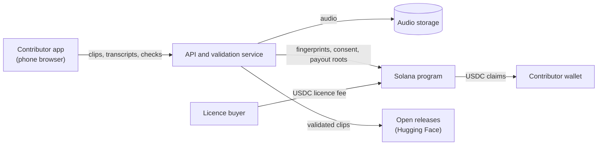

# Architecture

Sauti has five parts: the contributor app, the API and validation service, audio storage, the Solana program and the release pipeline.

## Contributor app

A mobile web app, so there is nothing to download. Sign-up uses a one-time code sent by SMS. A wallet is created in the browser and stays under the contributor's control. The app serves short prompts in each language, records clips, collects transcriptions and runs checks.

## API and validation service

- Receives each clip, computes a SHA-256 fingerprint of the audio and stores the file.
- Sends each clip to three native speakers of its language. A clip is validated when all three confirm it. Disputed clips go to a language lead.
- Fraud controls: phone-bound accounts, rate limits, reputation scores, random audits and exact-duplicate detection by fingerprint.

## Solana program

### v0, in this repository

- A `Contributor` account per contributor, derived from their wallet (seeds `["contributor", wallet]`), holding the consent fingerprint, the clip count and the registration time.
- `register_contributor` and `submit_clip`. Every clip emits a `ClipSubmitted` event carrying its audio fingerprint and language.
- Rent and fees can be paid by the Sauti relayer, so contributors never need SOL.

### Next

- **Validation records.** Validated clips are batched daily and each batch's Merkle root goes on-chain, so any clip can be proven part of a batch for a fraction of a cent per clip.
- **Weekly payouts.** Each week the service computes what every contributor earned and posts a payout Merkle root. Contributors claim USDC from a program-owned vault straight to their own wallet. Keeyo never holds contributor funds.
- **Licence revenue splits.** When a buyer licenses a curated dataset, the USDC fee is paid into the program and split among the contributors whose clips the dataset contains, through the same claim mechanism.

## Storage and releases

Audio is kept in object storage. Validated clips are packaged into open releases on Hugging Face under CC-BY 4.0. Each release comes with a datasheet, a licence and a benchmark: before and after error rates for a speech model fine-tuned on the data.

## Data protection

Built to Kenya's Data Protection Act, 2019, with registration at the Office of the Data Protection Commissioner. Consent is captured in plain language in the app and its fingerprint is recorded on-chain. Contributors can withdraw at any time: their audio is removed from storage and left out of future releases. Only fingerprints and payments go on-chain, never audio or personal details.
